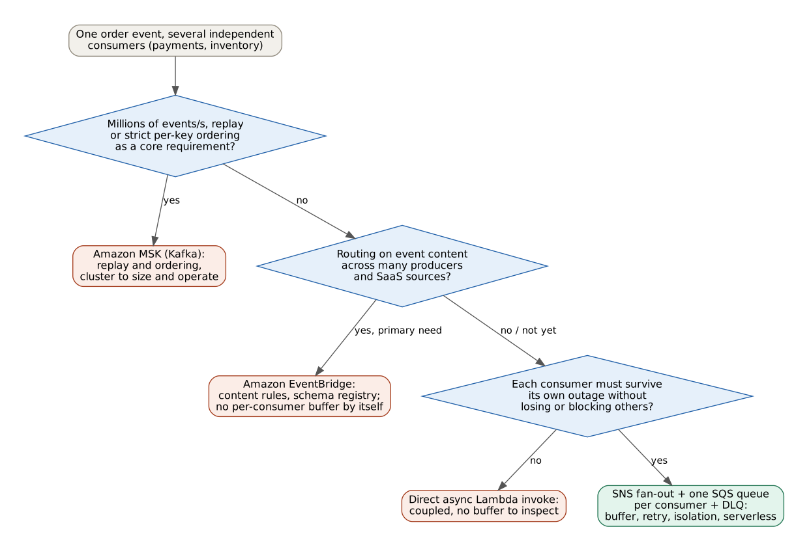
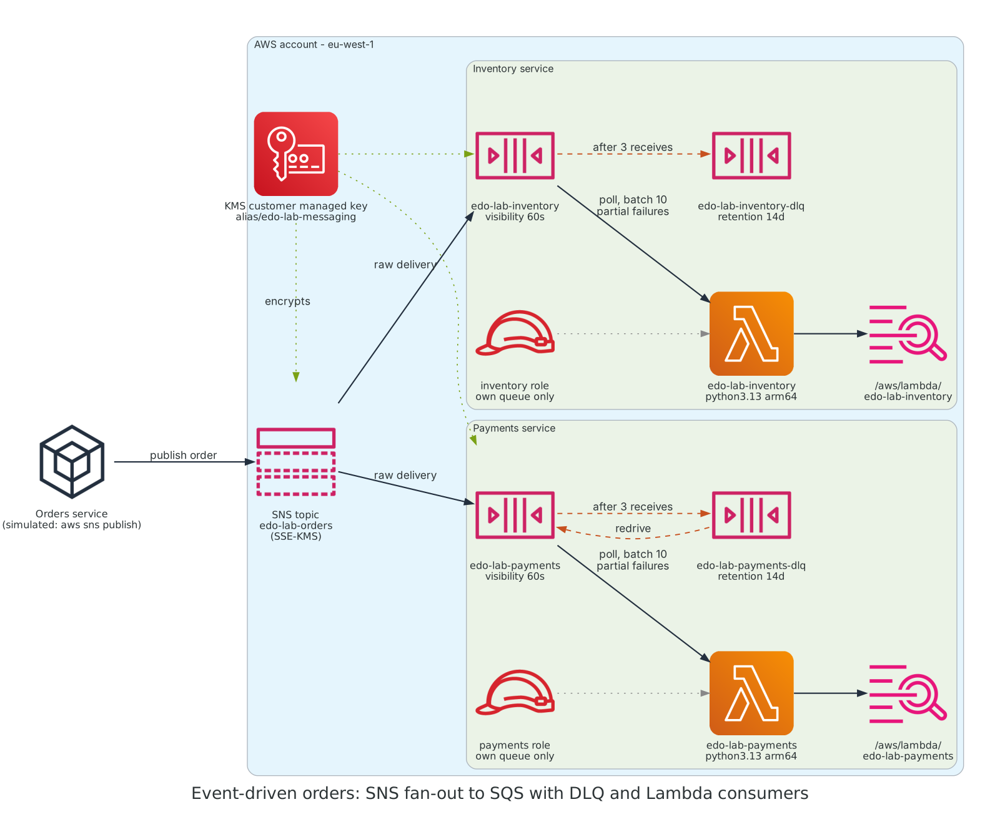
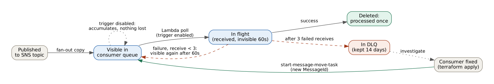

# Event-driven microservices with SNS, SQS and Lambda: fan-out, retries and dead-letter queues

Proof of concept, built end to end in Terraform and tested in a disposable AWS account, then destroyed.
It is written as it would be delivered to a client: request, analysis, decision, proposed solution, tests, costs and lessons learned.

**Architecture documentation**

| Document | Purpose |
|---|---|
| [ADR-001 — Messaging backbone](docs/adr/ADR-001-messaging-backbone-sns-sqs.md) | SNS + SQS vs EventBridge vs MSK (Accepted) |
| [ADR-002 — Failure handling](docs/adr/ADR-002-failure-handling-dlq-partial-batch.md) | Retries, DLQ, partial batch response, redrive (Accepted) |
| [ADR-003 — Encryption](docs/adr/ADR-003-encryption-customer-managed-kms.md) | Customer managed KMS key for topic and queues (Accepted) |
| [Technical debt register](docs/technical-debt-register.md) | Known gaps with reason, risk, exit trigger |
| [Runbook — DLQ triage and redrive](docs/runbook-dlq-redrive.md) | Operational procedure tested in this lab |
| [TOGAF / ITIL mapping](docs/governance.md) | Where each artifact sits in ADM phases and change management |

## 1. The request

An e-commerce platform is moving from a monolith to microservices. When an order is placed, several services must react:
payments must authorise the amount, the warehouse must reserve stock, and more consumers will follow (notifications, analytics).

Today these steps are synchronous calls: if the payment provider is slow or down, order placement fails or hangs, and a failed call is simply lost.

**Goal:** publish each order once and let every service process it independently, so that the outage of one service
neither blocks the others nor loses orders, and failed orders can be inspected and replayed.

## 2. Constraints

- No message loss: an order accepted by the platform must eventually be processed by every service, or be parked for investigation.
- Failure isolation: a broken consumer must not affect the other consumers.
- Data protection: order data encrypted at rest with a key under the customer's control, transport over TLS only.
- Least privilege per service: each service reads only its own queue.
- Small team: managed and serverless services, no brokers or clusters to operate.
- Everything defined as code, reproducible and destroyable.

## 3. Options considered



| Option | Fit for fan-out | Buffer and retry per consumer | Operations | Verdict |
|---|---|---|---|---|
| Synchronous calls / direct Lambda invoke | Producer knows every consumer | None to inspect | Low | Rejected: coupling is the problem to solve |
| Amazon MSK (Kafka) | Consumer groups, replay, ordering | Offsets per group, no DLQ out of the box | Cluster sizing, upgrades, partitions | Rejected: capabilities not needed at this volume |
| Amazon EventBridge | Content-based rules, many targets | Retry policy and DLQ per target, no queue to drain or pause | Serverless | Strong alternative, revisit when routing grows |
| **SNS fan-out + one SQS queue per consumer + DLQ** | Topic copies each order to every queue | Each queue buffers, retries and parks independently | Serverless | **Chosen** |

Details and trade-offs in [ADR-001](docs/adr/ADR-001-messaging-backbone-sns-sqs.md).

## 4. Proposed solution



1. The Orders service publishes the order (JSON) to the SNS topic `edo-lab-orders`. In this lab the producer is simulated with `aws sns publish`.
2. SNS delivers a copy to each subscribed queue: `edo-lab-payments` and `edo-lab-inventory`. Raw message delivery is on, so consumers receive the order JSON without the SNS envelope.
3. A Lambda event source mapping polls each queue in batches (up to 10 messages, 5 s batching window, maximum 2 concurrent instances) and invokes the service's function.
4. Each function processes the batch record by record and returns only the failed message IDs (`ReportBatchItemFailures`). Successful messages are deleted, failed ones become visible again after the 60 s visibility timeout.
5. After 3 failed receives SQS moves the message to the service's dead-letter queue, kept for 14 days. Once the cause is fixed, an operator moves the messages back with a managed redrive task.



**Security controls**

- One customer managed KMS key encrypts the topic and all four queues; the key policy allows SNS to use it only for this topic (`aws:SourceArn`).
- Queue policies accept messages only from SNS and only from this topic, and deny any request not made over TLS.
- Each service has its own IAM role: receive, delete and change visibility on its own queue only, `kms:Decrypt` only when the call comes through SQS (`kms:ViaService`), write only to its own log group. The managed `AWSLambdaBasicExecutionRole` is not used because it allows creating log groups on any resource.
- Each DLQ has a redrive allow policy that accepts only its own source queue.

### Repository layout

| Path | Content |
|---|---|
| `infra/versions.tf`, `providers.tf`, `variables.tf` | Terraform and provider versions, default tags for cost allocation, parameters (`max_receive_count` = 3) |
| `infra/main.tf` | Account and region data sources, shared names; the topic ARN is built as a string to avoid a dependency cycle with the key policy |
| `infra/kms.tf` | Customer managed key with rotation, key policy for SNS |
| `infra/sqs.tf` | Main queues and DLQs per consumer (`for_each`), redrive and redrive allow policies, queue policies |
| `infra/sns.tf` | Encrypted topic and SQS subscriptions with raw delivery |
| `infra/iam.tf` | One least-privilege role per consumer |
| `infra/lambda.tf` | Packaging, log groups with 7-day retention, functions, event source mappings |
| `src/payments`, `src/inventory` | Python consumers with partial batch response and a `SIMULATE_FAILURE` switch used by the tests |
| `tests/order-001.json` | Sample order event |
| `docs/` | ADRs, diagrams (sources in `docs/diagrams`), debt register, runbook |

Adding a consumer means adding one name to `local.consumers` and its handler in `src/`.

## 5. Tests performed

| # | Test | Expected | Result |
|---|---|---|---|
| 0 | Fan-out before consumers exist: publish one order, count messages | 1 message in each queue, body in clear text without SNS envelope | Passed: confirms key policy, queue policy and raw delivery together |
| 1 | Normal flow: publish one order with both consumers active | `PAYMENT_AUTHORIZED` and `STOCK_RESERVED` logged with `receiveCount` 1, queues empty | Passed |
| 2 | Consumer stopped: disable the payments trigger, publish 3 orders | 3 messages waiting in the payments queue, 0 in its DLQ; inventory processes all 3 | Passed: inventory handled the 3 orders in one invocation |
| 3 | Consumer failing: enable failure mode, re-enable the trigger | Each message received 3 times about 60 s apart, then moved to the DLQ | Passed: 9 `PAYMENT_FAILED` log lines, `receiveCount` 1 → 2 → 3, DLQ = 3, main queue = 0 |
| 4a | Drift: the failure mode was set outside Terraform | `terraform plan` shows the change and `apply` restores the declared state | Passed: 1 in-place change on the payments function only |
| 4b | Redrive: `start-message-move-task` on the DLQ | 3 messages moved, 3 payments authorised, all queues empty | Passed |
| 5 | Final `terraform plan` | No changes | Passed |

Tests 2 and 3 show the two different failure modes of a consumer. A **stopped** consumer (trigger disabled) never receives the messages,
so they accumulate safely until retention expires and never reach the DLQ. A **failing** consumer receives them and the retry counter
drives them to the DLQ. Operations need to recognise which of the two is happening: queue depth growing versus DLQ depth growing.

Evidence from test 3, one message traced through its three attempts (the retention of the logs is 7 days, these lines are copied from the run):

```text
14:06:06  PAYMENT_FAILED  messageId 072652a0-…  receiveCount 1  Simulated payment gateway outage
14:06:57  PAYMENT_FAILED  messageId 072652a0-…  receiveCount 2  Simulated payment gateway outage
14:07:57  PAYMENT_FAILED  messageId 072652a0-…  receiveCount 3  Simulated payment gateway outage
```

The same message ID was then found in the DLQ, with the original body intact.

## 6. Cost notes

The whole lab is expected to cost a few cents (to be confirmed in Cost Explorer with the `Project` tag once billing data is available). Figures that matter when the design is scaled:

- **Lambda** (arm64, 128 MB): one record took 11–15 ms, a batch of 3 records 62 ms, with 35 MB of memory used.
  Cold starts added 84–94 ms of init, and init is billed for zip-based on-demand functions, so on very short functions the cold start costs more than the code.
  arm64 (Graviton) is cheaper than x86 per GB-second.
- **Batching** is the main lever: with a 5 s batching window the 3 inventory messages of test 2 were processed in one invocation instead of three.
- **SQS** charges per request, including empty receives. Long polling (20 s) on the queues and the 5 s batching window keep the number of requests low;
  the event source mapping polls continuously while enabled, which is a small fixed cost per queue even with no traffic.
- **SNS**: publishes are billed, deliveries from SNS to SQS are not.
- **KMS**: the customer managed key has a monthly fee prorated hourly plus a per-request charge. `kms_data_key_reuse_period_seconds = 300` lets SQS reuse a data key for 5 minutes instead of calling KMS for every message.
- **CloudWatch Logs**: log groups are created by Terraform with 7-day retention. Without this, Lambda creates them on first invocation with no expiry, a cost that grows silently.
- All resources carry the `Project`, `Environment` and `ManagedBy` default tags, so the stack can be isolated in Cost Explorer.

## 7. Lessons learned

- **At-least-once means duplicates, design for idempotency.** SQS standard queues and the redrive can deliver the same order more than once. In this lab the same order ID was "paid" several times and nothing noticed. A real consumer needs an idempotency key (see TD-001 and the lab 2 outline).
- **Redrive creates new messages.** After `start-message-move-task` the messages had a new MessageId and `receiveCount` restarted from 1. End-to-end tracing must use a business key (`orderId`) or a correlation ID carried in the body, not the SQS message ID.
- **Stopped is not failing.** A disabled trigger lets messages accumulate without retries; only a consumer that receives and fails drives them to the DLQ. Alarms are needed on both queue depth / age of oldest message and DLQ depth.
- **Partial batch response must be enabled twice.** The function must return `batchItemFailures` *and* the event source mapping must declare `ReportBatchItemFailures`; without the second, the response is ignored and one failure retries the whole batch.
- **Visibility timeout is the backoff.** Attempts were about 50–60 s apart because of the 60 s visibility timeout (6× the function timeout, as recommended). With `maxReceiveCount` 3 a broken consumer parks messages in about 3 minutes: tune both to the expected recovery time of the downstream system.
- **SQS counters are approximate.** `ApproximateNumberOfMessages` read `0` a few seconds after publishing and `3` shortly after. Runbooks and tests must allow for eventual consistency.
- **KMS with SNS needs a customer managed key.** SNS cannot use the AWS managed `aws/sqs` key to write to encrypted queues. Building the topic ARN as a string avoids a dependency cycle between the key policy and the topic.
- **Manual changes are visible.** The failure mode was switched on with the CLI during the test; the next `terraform plan` reported exactly that change and `apply` reverted it. Emergency changes made in the console are caught the same way.
- **CloudWatch filter syntax and PowerShell quoting do not mix.** A filter term with an underscore must be quoted for CloudWatch, and PowerShell strips the quotes; piping `aws logs tail` into `Select-String` is simpler and reliable.

## 7.1 What changed compared to a few years ago

- Partial batch response for SQS (2021): before it, a single failure retried the whole batch.
- Managed DLQ redrive (`start-message-move-task`, 2023): before it, redrive was a custom receive/send/delete script.
- Maximum concurrency on the SQS event source mapping (2023): before it, reserved concurrency on the function was the only throttle.
- AWS provider 6.x: per-resource `region` attribute, `data.aws_region.current.region` replaces `.name`.
- Lambda init phase billing for zip-based on-demand functions (2025).

## 8. Next step: lab 2 outline

This lab exercised the messaging engine. Lab 2 adds a thin vertical slice around it, without a frontend (curl is the client), to close the main gaps found here:

| Addition | Closes |
|---|---|
| API Gateway `POST /orders` and an Orders Lambda as real producer | Producer simulated with the CLI |
| DynamoDB orders table; Orders writes the order, then publishes | No system of record; introduces the dual-write problem (outbox pattern or DynamoDB Streams as options) |
| Idempotent consumers: conditional write on `orderId` per service, order status updated by each consumer | TD-001 |
| CloudWatch alarms on DLQ depth and age of oldest message | TD-003 |
| X-Ray tracing and a correlation ID end to end | TD-004 |
| Deny-insecure-transport policy on the DLQs | TD-002 |

## 9. How to run

Prerequisites: Terraform >= 1.10, AWS CLI v2 with an SSO profile.

```bash
aws sso login --profile <profile>
export AWS_PROFILE=<profile>          # PowerShell: $env:AWS_PROFILE = "<profile>"
cd infra
terraform init
terraform plan -out tfplan
terraform apply tfplan

aws sns publish --topic-arn arn:aws:sns:eu-west-1:<account-id>:edo-lab-orders --message file://../tests/order-001.json
aws logs tail /aws/lambda/edo-lab-payments --since 5m --format short

terraform plan -destroy -out tfplan
terraform apply tfplan                # the KMS key stays "pending deletion" for 7 days
```

Region `eu-west-1`. State is local in this lab and never committed (see `.gitignore`); a shared project needs an encrypted remote backend.
